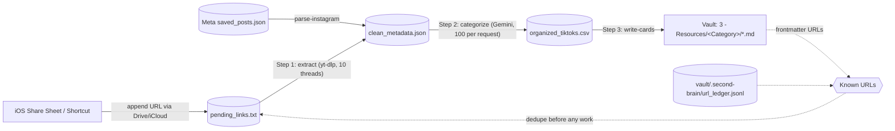

# obsidian-second-brain-pipeline

> Independent project; not affiliated with or endorsed by Obsidian.

Turn the short-form videos you save on TikTok and Instagram into small, actionable Markdown cards in an [Obsidian](https://obsidian.md) vault organized with P.A.R.A.

You capture on the phone (the iOS Share Sheet appends a URL to a synced text file). Later, one click on the desktop pulls metadata with `yt-dlp`, has Gemini sort about 100 videos per request into 14 categories, and writes one card per video into `3 - Resources/<Category>/`. From there you triage cards with Dataview hubs, Kanban boards, and so on.

This repo holds the pipeline code and templates only. Your vault, queue files, Instagram export, and API key stay local and are gitignored.

## Architecture



```
[iOS Share Sheet] --append URL--> pending_links.txt
  Step 1   second-brain extract          yt-dlp metadata        -> clean_metadata.json
  Step 1b  second-brain parse-instagram  Meta export, no yt-dlp -> clean_metadata.json
  Step 2   second-brain categorize       Gemini mega-batches    -> organized_tiktoks.csv
  Step 3   second-brain write-cards      Markdown cards         -> <vault>/3 - Resources/<folder>/
```

### Guarantees

| Concern | How it is handled |
|---|---|
| Gemini free tier (about 20 requests/day, resets at midnight Pacific) | 100 items per request, compact output schema `{i, cat, summ}`, exponential backoff with jitter on `429`. If the error names a per-day quota, the run stops without retrying. |
| No duplicate work | Before extraction, a URL is skipped if it is in any card's frontmatter (the vault is the registry), in the ledger, or already waiting in a queue file. URLs are normalized first: tracking parameters such as `igsh`, `utm_*`, `is_from_webapp`, and `sender_device` are removed, so the same video shared twice counts once. |
| Deleted and tossed cards stay gone | `<vault>/.second-brain/url_ledger.jsonl` records every URL that became a card. Deleting a card does not make its URL "new" again. |
| Crash safety | Queues are "pop on success": each item or batch is removed only after its output is written and `fsync`ed. Every rewrite is atomic (temp file, fsync, rename). A crash at any point can repeat at most the in-flight item, and dedupe then skips it. |
| Zero waste | Intermediate queues (`clean_metadata.json`, `organized_tiktoks.csv`) are deleted when empty. `pending_links.txt` is cleared in place instead, so Google Drive / iCloud Shortcut targets stay linked. |

## Repository layout

```
LICENSE                       MIT
run_pipeline.bat              One-click Windows entry point (steps 1-3)
config.example.yaml           Copy to config.yaml (gitignored)
.env.example                  Copy to .env (gitignored) for GEMINI_API_KEY
src/second_brain/
  cli.py                      `second-brain <command>` / `python -m second_brain`
  config.py                   config.yaml loading and validation
  steps/extract_metadata.py   Step 1   (was 1_extract_metadata.py)
  steps/parse_instagram.py    Step 1b  (was 1_parse_instagram_json.py)
  steps/categorize.py         Step 2   (was 2_categorize_mega_batch.py)
  steps/write_cards.py        Step 3   (was 3_csv_to_obsidian.py)
  steps/registry.py           Known-URL check shared by all steps
  vault.py  ledger.py         Frontmatter scan, card writing, URL ledger
  gemini.py io_utils.py       Backoff and atomic/fsynced file helpers
  taxonomy.py                 Category -> folder map
  crusher/                    Multimodal re-analysis (`second-brain crush`)
  model_a/                    Experimental deep-analysis track (see below)
  model_b/                    Travel pins: keyframes, audio fallback, Nominatim (see below)
  model_c/                    Music, Fitness, and Recipes actionable notes (see below)
examples/sample-vault/        Fake vault: a few cards, a Comedy Hub, a Kanban board
tests/                        pytest suite (Gemini is mocked, no network)
```

## Setup (Windows)

Prerequisites: Python 3.10+ ([python.org](https://www.python.org/downloads/windows/); tick "Add python.exe to PATH") and Obsidian with the Dataview plugin.

```powershell
git clone <this repo> obsidian-second-brain-pipeline
cd obsidian-second-brain-pipeline
python -m venv .venv
.\.venv\Scripts\Activate.ps1          # if blocked: Set-ExecutionPolicy -Scope CurrentUser RemoteSigned
pip install -e .                      # also installs yt-dlp
copy config.example.yaml config.yaml
copy .env.example .env
notepad config.yaml                   # set vault_path and pending_links_path
notepad .env                          # paste your Gemini key
```

The distribution is named `obsidian-second-brain-pipeline`. The command it installs is `second-brain`, and the Python package it imports is `second_brain`.

Get a free Gemini API key from [Google AI Studio](https://aistudio.google.com/apikey). The key is read from `GEMINI_API_KEY` (or `GOOGLE_API_KEY`), either as a real environment variable or from `.env`. Never put secrets in `config.yaml` (only env var **names** under `llm.api_key_env_vars`).

**Choose your AI:** crush, categorize, and model-a share one `llm:` block (native Gemini or any OpenAI-compatible `base_url` + model id). Run `second-brain setup` for a wizard, or `second-brain doctor` to verify key, text, and vision. Omit `llm:` to keep the legacy defaults (`gemini.model` + crusher key rotation).

PowerShell 5.1 has no `&&`. Chain commands with `;` plus `if ($?) { ... }`, or use `run_pipeline.bat`.

## Configuration

Everything machine-specific lives in `config.yaml`. See `config.example.yaml` for the full list with comments. The important keys:

| Key | Meaning |
|---|---|
| `vault_path` | Vault root, the folder containing `3 - Resources`. On Windows use forward slashes: `D:/Obsidian/The Brain`. |
| `pending_links_path` | The file your iOS Shortcut appends to, for example `G:/My Drive/Inbox/pending_links.txt`. |
| `data_dir` | Where `clean_metadata.json` and `organized_tiktoks.csv` live (default `./data`, gitignored). |
| `ledger_path` | Persistent URL ledger. Default: `<vault_path>/.second-brain/url_ledger.jsonl`, a hidden folder that Obsidian does not index, so the ledger syncs and backs up along with the vault. |
| `gemini.*` | Categorize batch size (100), retries, backoff, pause between batches (model id moves to `llm` when set). |
| `llm.*` | Provider (`gemini` or `openai`), model, `api_key_env_vars`, vision/audio flags, prices for spend caps. |
| `taxonomy` | Optional replacement for the default category-to-folder map. |

Relative paths are resolved from the folder that contains `config.yaml`. Use `--config PATH` or `SECOND_BRAIN_CONFIG` to point somewhere else.

## Running

One click: double-click `run_pipeline.bat` (or pin a shortcut to the taskbar). It activates `.venv` if present, runs steps 1 to 3, and stops at the first real error.

Or run commands individually:

```powershell
second-brain extract            # Step 1
second-brain categorize         # Step 2 (uses Gemini)
second-brain write-cards        # Step 3
second-brain run                # pending_links.txt -> classify -> cards (pipeline lock)
second-brain parse-instagram    # one-off: import a Meta "saved items" export instead of Step 1
second-brain ledger-sync        # record vault URLs + tossed cards in the ledger
second-brain migrate-travel     # dry-run: backfill Travel Map View frontmatter
second-brain migrate-travel --apply   # write Travel schema + ensure Hub/Map notes
second-brain crush              # dry-run: multimodal re-analysis -> cache + report
second-brain crush --apply      # rewrite cards from cache (recategorize, findings, children)
second-brain model-c-ingest     # same queue as run; Music, Fitness, Recipes get checklists
second-brain migrate-cards      # dry-run: legacy status -> stage, legalize tags
second-brain migrate-cards --apply
second-brain -v <command>       # debug logging
```

Example output:

```
23:18:52 INFO    Scanning Obsidian vault for existing cards...
23:18:52 INFO    Skipped 3 URL(s) already in The Brain, the ledger, or the queue.
23:18:53 INFO    Found 240 video(s) to categorize (~3 request(s)).
23:18:53 INFO    Generated 240 new card(s) in The Brain (0 already known).
23:18:53 INFO    CLEANUP: All cards generated. 'organized_tiktoks.csv' deleted.
```

Exit codes: `0` means done, including a Gemini run that stopped early with its queue intact (Step 3 still writes whatever was categorized). `2` means a config or setup problem. `1` means an unexpected error.

### Triage and deleting cards

Cards are created with `status: "inbox"`. Set `status` to `kept`, `promoted`, or `tossed` as you triage. Pipeline state is a separate `stage` field: `ready` (fitness and recipes), `to-watch` (movies), `manual-review`, or `archived` (you set this after moving a track to a playlist). Every card the pipeline writes is recorded in the ledger. For cards that existed before you started using the ledger, run `second-brain ledger-sync` once before deleting anything. Step 1 also runs this sync automatically on each run. `second-brain migrate-cards` (dry-run; add `--apply` to write) moves older `ready` / `To Watch` / `manual-review` / `archived` values out of `status` into `stage`.

### Try it with the sample vault

`config.example.yaml` points at `examples/sample-vault/The Brain`, so you can open that folder in Obsidian to see the card format, the `Comedy Hub.md` Dataview table, and the Movies Kanban board.

## Crusher (multimodal re-analysis)

``second-brain crush`` walks existing vault cards (in configurable batches) and works out
what each video actually contains. It is built for the edge cases metadata-only Step 2
misses: destination slideshows, on-screen song/album lists, silent clips, and misleading
captions.

It is **tiered to stay cheap** (target: well under $15 for ~2,000 videos). Each URL
escalates only as far as it needs to:

1. **Metadata**: one ``yt-dlp`` JSON call (title, caption, duration, caption-track URLs).
2. **Captions**: fetched straight from the caption-track URL. Free, no download.
3. **Audio**: only when captions are missing. Downloads the smallest audio stream and
   transcribes it locally with faster-whisper (``pip install -e ".[transcribe]"``). Free.
4. **Keyframes**: only when the content is likely on screen (carousel, silent, a list
   claim with little speech, or the text summary came up short). Downloads a <=360p
   file and sends at most ``max_keyframes`` <=512px frames.

A Gemini call then writes the summary and items from that text (plus frames when
present). Classification (category, media shape, relevance 0-5, content tags) uses
[Jev](https://www.jevtypesafeai.com/how-to-use) when ``TYPESAFE_API_KEY`` is set;
otherwise it uses the Gemini summary's own fields. Full-resolution video is never
downloaded.

Every ``yt-dlp`` process goes through one rate-limited runner. It retries 429/5xx/timeouts
with backoff. Transient failures are marked ``failed-retryable`` and retried next run;
only dead, private, or blocked links become ``unavailable``. An item that still has no
analysis after ``manual_review_after_attempts`` is appended to ``data/crusher_manual_review.md``
and is not retried until ``--reprocess``. Incomplete-but-usable analyses stay ``needs-review``
instead, so that list stays near 1% of a normal batch. Metadata and transcripts are
cached per URL, so a ``prompt_version`` bump re-runs only the paid summary.

Set ``crusher.price_input_per_m`` / ``price_output_per_m`` for your model, then cap
spend with ``max_total_spend_usd`` (all runs) or ``--max-spend 2.50`` (this run). The
report ends with a per-run summary: how many items stopped at each tier, spend, and
average cost per item. Run ``second-brain crush --limit 50`` first and check that
average before running the full vault.

Default mode is a **dry run**: analyses are cached under
``<vault>/.second-brain/crusher_cache/``, progress is recorded in
``crusher_state.jsonl``, and a summary lands in ``data/crusher_report.md``.
Re-run with ``--apply`` to rewrite frontmatter, insert a ``## Video Analysis`` block,
recategorize/move cards (unless ``category_locked: true``), and split multi-item videos
into child notes (``--no-children`` to disable).

Quota is **config-driven** (``crusher.requests_per_day``, ``requests_per_minute``,
``tokens_per_minute`` — use ``null`` for unlimited). Fallback keys are incremental:
set ``GEMINI_API_KEY``, ``GEMINI_API_KEY_2``, ``GEMINI_API_KEY_3``, and so on (any
count, no gap in the numbers). When one key's daily quota is exhausted the same
request is retried on the next key, and the run stops only after the last key is
spent. Requires **ffmpeg**
on PATH for probing, keyframes, and slide detection (``-fps_mode`` needs ffmpeg 5.1+).

## Model A (experimental)

`model_a/` holds a deeper-analysis track, which is not part of the `.bat` file:

- `second-brain model-a-ingest` is the same dispatcher as `second-brain run`. It reads `pending_links_path` only. Tech & Coding, Project Ideas, and Movies & Shows are transformed after classification. Movies get `stage: to-watch` and stay `status: inbox`. A non-empty legacy Model A inbox is logged and left in place.
- `second-brain model-a-enrich` re-classifies existing cards in those folders, 10 per request. It adds criteria tags (genre, tool, project time), renames files, and adds movies to `!Watchlist Kanban.md`. Your notes section and triage status are preserved.

## Model C (Music, Fitness, Recipes)

`model_c/` turns Saved Music, Fitness & Health, and Recipes & Food into usable notes after something else has classified them. `second-brain run` and `second-brain model-c-ingest` both read `pending_links_path`. A leftover `model_c_pending.txt` is logged and not popped.

When `TYPESAFE_API_KEY` is set, each URL is fetched through the crusher's paced yt-dlp runner and classified with Jev. Otherwise the Gemini mega-batch supplies the category. The extraction schema has no category field. Songs are filed as `Saved Music` in the Music folder (`status: inbox`, artist and sound). Fitness and recipes get checkbox sections and `stage: ready`. Extraction confidence below 0.60, low Jev confidence, a dead link, or an unparseable response is `stage: manual-review` under `Inbox/Manual Review`. A timeout or HTTP 429 stays in the queue and is not ledgered. A Gemini 429 still stops the run.

`crush --apply` keeps Exercises, Ingredients, Artist & Sound, and Review sections along with Notes. Stock hubs are created for every taxonomy folder when missing. The Music hub lists unarchived tracks from the last 7 days (`stage` is not `archived`). Fitness and Recipes hubs list every note that is not tossed, so an older inbox card and a `stage: ready` card show up together. The keyframe tier needs `pip install -e .[model-a]`.

## Model B (Travel)

`model_b/` turns a clip already classified as Travel into a map pin. `second-brain run` and `second-brain model-b-ingest` both read `pending_links_path`. Tier 1 is the dispatcher's yt-dlp JSON metadata. A caption shorter than `model_b.sparse_text_chars` (default 40) samples keyframes at 25%, 55%, and 85% of the lowest-resolution mp4 before any audio call. If the clip is travel but still has no place name, it falls back to low-bitrate audio (`yt-dlp -x`) and one more Gemini call. A long caption skips the download.

`status` stays `inbox` so triage and the Travel Hub keep working. The pin outcome is `stage`:

- `mapped` — confidence at least `model_b.confidence_threshold` (default 0.50) and Nominatim returned coordinates. The card is under `3 - Resources/Travel/` with `location: [lat, lon]` and `address`.
- `unmapped-travel` — travel is confirmed but geocoding missed, the place name was empty, or `crusher.geocoder` is `none`. Same folder, no `location` or `address`.
- `manual-review` — confidence is below the threshold, or the extractor says the clip is not travel. The card goes to `Inbox/Manual Review`.

Tags are `saved-media`, `category/travel`, and `travel/mapped`, `travel/unmapped`, or `travel/manual-review`. Nominatim is called through geopy's `RateLimiter` (1.1 seconds between requests) with `crusher.geocoder_user_agent`. A Gemini 429 still stops the run and leaves the URL in the queue. Without a Jev key, the mega-batch path writes the older travel stub and does not geocode.

## Model D (universal hubs and triage)

`model_d/` is the catch-all for resource folders that do not belong to Model B or Model C: Art & Spaces, Relationships, Comedy, and any folder you add later under `3 - Resources/`.

`second-brain model-d --scaffold` walks the direct children of `3 - Resources/`. It skips `Inbox`, dot-folders, and the model-owned folders `Music`, `Fitness & Health`, `Recipes & Food`, and `Travel`. When `<Folder Name> Hub.md` is missing, it writes the 3-part hub: a Dataview inspiration stream (`status` and `stage` both hide `tossed` and `manual-review`), a Synthesis & Scrapbook section, and a triage checklist, plus a collapsed callout for notes still marked manual-review. An existing hub is never overwritten. `--scaffold --repair` refreshes a hub only when its text still equals the previous stock template, so a hand-edited scrapbook stays put.

`second-brain model-d --triage` lists notes in `Inbox/Manual Review` and any note whose `status` is `inbox` or `manual-review`, or whose `stage` is `manual-review`. Keys are `k` keep, `m` move (one folder name under Resources; the taxonomy key and `category/` tag are updated), `p` promote (into `1 - Projects/<Project Name>/` with `status: promoted`), `t` toss (hides the note; a second confirmation is required to delete it), `s` skip, and `q` quit. The note body is not rewritten. A move writes the new file and only then deletes the original. If the destination name is taken, the new file gets a `(2)` suffix. Deleting records the URL in the ledger first. Folder and project names are a single path segment, so triage input cannot write outside the vault.

The same hub layout is in `templates/Universal Category Hub.md` for Templater. Create the note inside the category folder, then insert the template so `tp.file.folder(true)` becomes that folder's vault path.

## Development

```powershell
pip install -e .[dev]
pytest
```

The tests cover frontmatter dedupe, queue pop-on-success and crash recovery, the ledger, 429 backoff, 100-item Gemini response parsing (with a mocked client), Instagram parsing, config validation, and a guard that fails if a hardcoded Windows user-profile path or a Google API key appears in the repo.

## Security and privacy

- Secrets: the Gemini key comes only from the environment or a gitignored `.env`. In a managed environment, inject `GEMINI_API_KEY` from a secret store (for example Azure Key Vault) instead of using `.env`.
- Personal data: the vault, `pending_links.txt`, queue files, the ledger, `saved_posts.json`, and browser cookies are all gitignored. `cookies_from_browser` only names a browser. yt-dlp reads the cookies at runtime, and they are never written to disk by this tool.
- Untrusted input: lines in `pending_links.txt` must be http(s) URLs. They are passed to yt-dlp as a list (no shell) after `--`, so they cannot inject options. Model output is never used as a path: unknown categories go to `Inbox`, and titles are sanitized for Windows file names.

## Known limitations

- `second-brain run` (and `model-a-ingest` / `model-b-ingest` / `model-c-ingest`, which call the same dispatcher) take `<vault>/.second-brain/pipeline.lock`. `second-brain crush` takes `crusher.lock` instead. `extract`, `categorize`, and `write-cards` do not take a lock; do not run those beside `run`.
- TikTok short links (`vm.tiktok.com/...`) are not resolved to the canonical video URL, so a short link and a full link to the same video count as two URLs.
- Tags such as `category/movies-&-shows` are kept for compatibility with existing vaults, even though Obsidian does not treat `&` as a valid tag character.

## Roadmap

- `second-brain migrate-cards` rewrites illegal category tags, maps `second-brain` to `saved-media`, moves `To Watch` / `manual-review` / `ready` / `archived` into `stage`, and refreshes stock hubs that still match a previous template. It does not yet re-normalize stored `url:` values.
- Hub scaffolding for Music, Fitness, Recipes, and Travel stays with those models. `second-brain model-d --scaffold` creates a `<Category> Hub.md` for every other direct child of `3 - Resources/` when the hub is missing.
- Mobile capture: finish the iOS Shortcut that writes to a Drive or iCloud `pending_links.txt`.
- Obsidian promotion action: Model D's terminal triage already sets `status: promoted` and moves the card to `1 - Projects/`. A one-click command inside Obsidian is still open.

## License

[MIT](LICENSE) © 2026 Benjamin Plichta. "Obsidian" is a trademark of its owner. It is used here only to describe compatibility.
